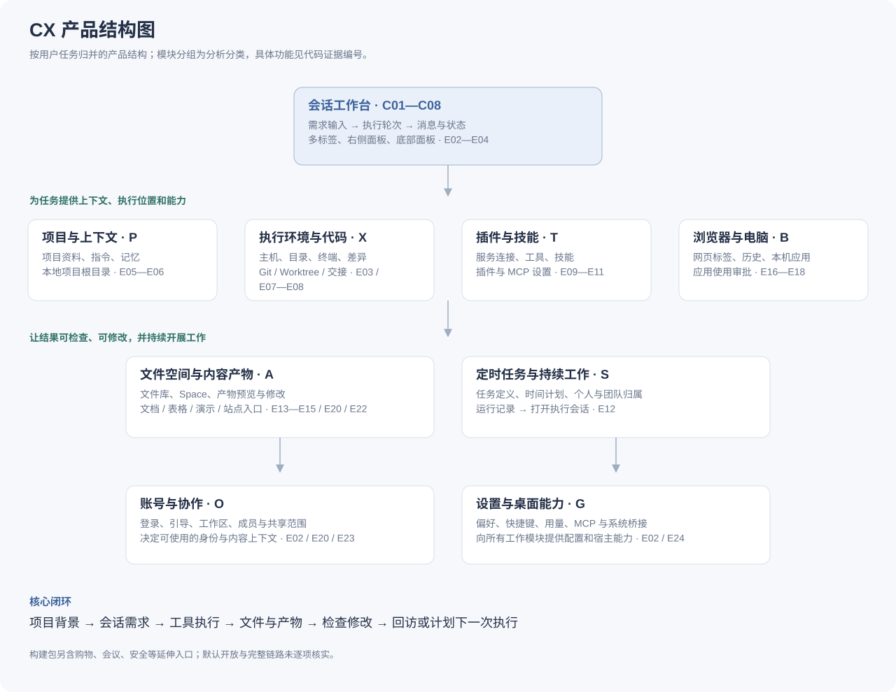
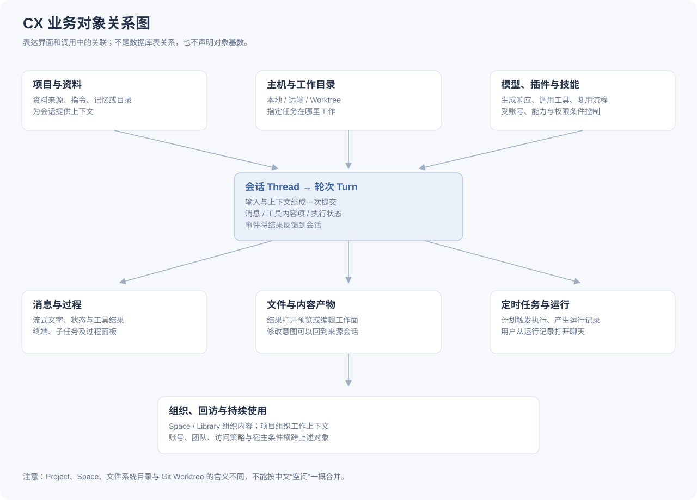
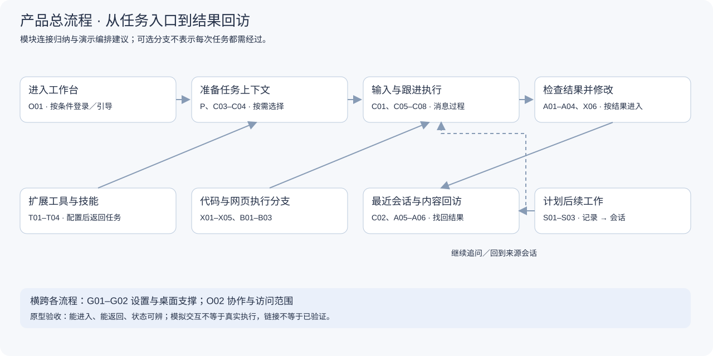
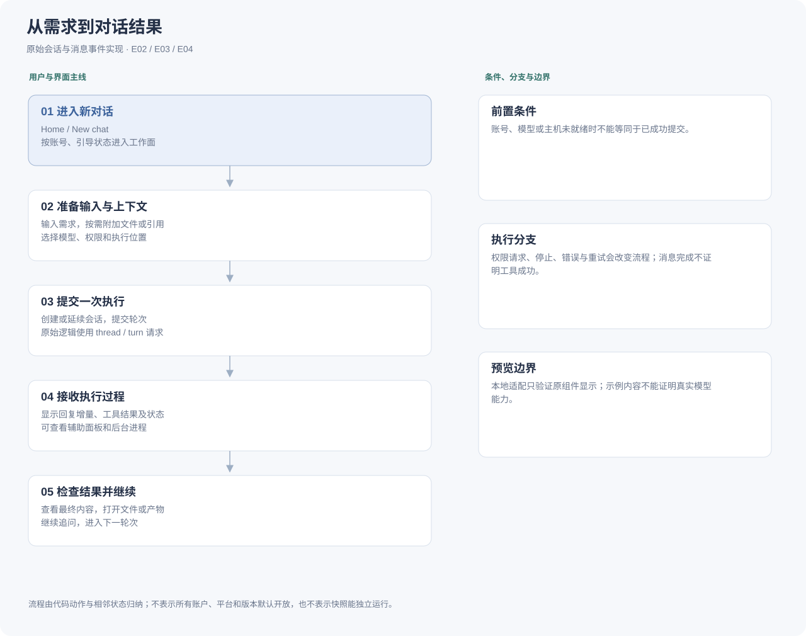
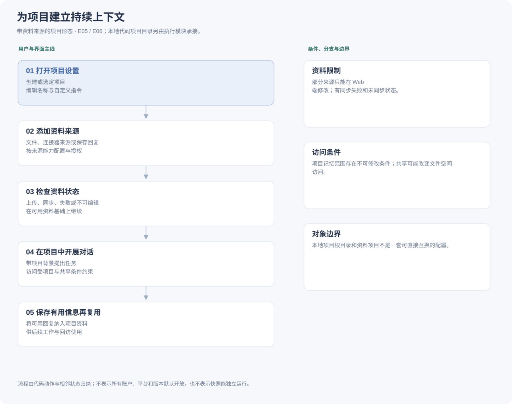
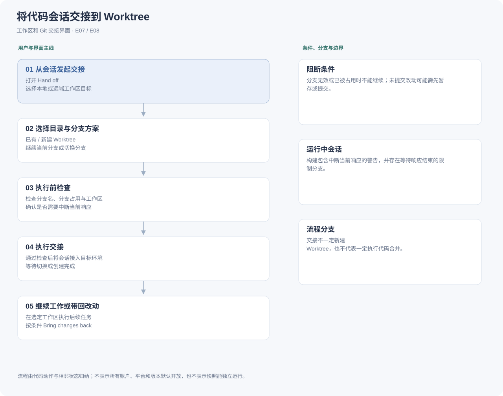
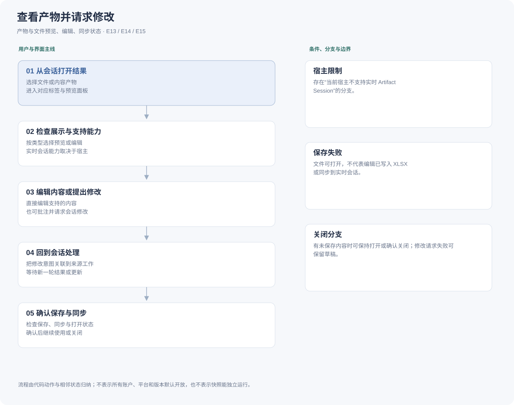
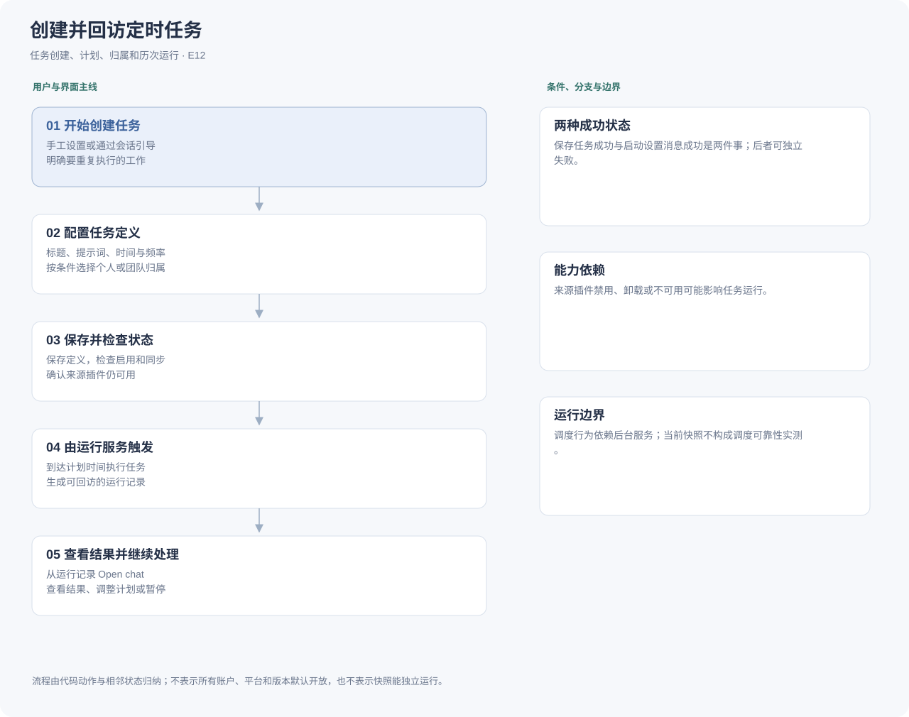

# CX 产品全貌

代码核对基线：2026 年 11 月 16 日 · 文档更新：2026 年 11 月 18 日

**CX 是一套以会话为工作入口、把项目上下文、工具执行和内容产物连接起来的桌面工作台。**这是对当前实现的产品分析，不是已经核实的官方定位。代码可直接确认的组成包括会话、项目、执行环境、插件与技能、文件与产物、浏览器与电脑操作、定时任务，以及账号和设置。

当前快照的 package 产品名为 **DreamArk**，声明版本为 `26.1016.62342`，构建号为 `21477`。目录缩写 CX、界面残留图标或内部符号，不足以鉴定改名之前的产品身份。[E01](#e01)

本交付只分析 `frontend-ref-main/cx-ref/` 与它在仓库根目录的 `package.json`。以未修改的原始文件为依据；此前本地对话预览中的模拟账号、消息、回复和宿主适配，都不作为产品能力证据。

## 全产品预览

**[全产品 Figma Prototype · 主要流程串联版（模拟）](https://www.figma.com/proto/kLidtlg6DvuSM9u1D6F6rm/CX?page-id=1970%3A85593&node-id=2624-6427&starting-point-node-id=2624%3A6427&scaling=contain&hide-ui=1)**。从模拟登录进入统一工作台，通过产品内导航访问九组主要界面。主要任务、状态保留与返回已实测；这不表示 38 个编号的全部状态都已验收，具体见 [6.11 串联验收记录](#6-11-2026-11-18-串联验收记录)。

| 入口或记录 | 当前内容 |
| --- | --- |
| 全产品播放链接 | [从模拟登录开始完整播放](https://www.figma.com/proto/kLidtlg6DvuSM9u1D6F6rm/CX?page-id=1970%3A85593&node-id=2624-6427&starting-point-node-id=2624%3A6427&scaling=contain&hide-ui=1) |
| 主设计文件 | [复现专项 · CX 代码复刻](https://www.figma.com/design/kLidtlg6DvuSM9u1D6F6rm/复现专项?node-id=1970-85593) |
| 演示范围 | C、P、X、A、T、B、S、O、G 主要入口串联；沿用现有界面，未新增 Figma Page；逐编号覆盖与缺口见功能目录 |
| 能力说明 | 无后台能力采用明确标记的模拟或预设交互；不表示真实模型、账户、终端或任务服务已接通 |
| 交付版本 | 2026-11-18 串联验收记录；这是文档记录名称，文档由本仓库提交历史记录；尚未建立 Figma 命名版本或 GitHub Release |

**阅读方式：**先看产品结构，再按功能目录进入可编辑界面或局部 Prototype；第 6 节说明用户任务如何跨模块衔接。全产品入口用于完整体验，局部入口用于逐项核对。

## 1 阅读结论与证据口径

### 1.1 这个产品由什么组成

产品有三个相互衔接的层次。**会话工作台**接收需求并承载过程；**项目与执行能力**提供资料、文件目录、模型、工具和工作环境；**结果与持续工作**负责文件产物、回访、修改和定时执行。账号、访问条件、设置与桌面宿主横跨这些层次。

聊天是这套结构的入口。执行不全在聊天文字内发生：终端、代码改动、浏览器、文件和内容编辑会进入不同的面板或工作面，再与来源会话关联。[E02](#e02) [E03](#e03) [E04](#e04) [E13](#e13)

### 1.2 如何区分事实与判断

| 标记 | 在本文中的含义 | 不能据此推出的结论 |
| --- | --- | --- |
| 代码事实 | 已读到路由、组件组合、对象字段、状态分支或调用逻辑 | 服务端真实可用、所有账户默认开放 |
| 文案事实 | 已读到当前构建中的操作文案、状态和提示 | 用户一定能走完整条流程，功能已上线 |
| 模块线索 | 文件名、导出名或局部引用支持该入口存在 | 完整页面结构、默认导航、真实用户人群 |
| 产品分析 | 根据上述事实归纳目标人群、价值和模块边界 | 官方定位、用户规模、市场验证、商业效果 |

下文功能目录中的“事实”包含代码事实和相邻文案事实；“线索”会单独标明。图中的模块划分是便于理解的分析分类，**不是宣称原产品有九个固定的一级导航**。构建中存在多个工作面和共享资源，页面开放受账号、平台、模式和开关影响。[E02](#e02) [E19](#e19)

## 2 服务谁与解决什么任务

### 2.1 代码能够证明的使用场景

| 代码可确认的能力组合 | 对应任务 | 支持证据 |
| --- | --- | --- |
| 自然语言输入、会话消息、流式增量、继续发送 | 把需求交给助手，跟进过程并追问 | E02、E03 |
| 项目资料、自定义指令、项目记忆及访问配置 | 让多次工作共享某个项目的背景和资料 | E05、E06 |
| 本地目录、执行主机、环境、Git worktree、交接 | 在代码或文件工作环境中开展任务、并行工作或转移上下文 | E03、E07、E08 |
| 文件与内容预览、修改请求、表格与幻灯片编辑状态 | 查看、调整和回访工作结果 | E13、E14、E15 |
| 浏览器工作面、电脑应用审批、操作与截图说明 | 使用网页及本机应用完成任务 | E16、E17、E18 |
| 定时任务、频率、运行记录、个人或团队归属 | 周期性执行检查、提醒和跟踪任务 | E12 |
| 插件、技能、MCP 服务配置 | 给助手扩展数据来源和可执行能力 | E09、E10、E11 |

### 2.2 目标人群与定位分析

以下是产品分析，不能当作官方用户画像。

| 推断的人群 | 可能需要解决的任务 | 为什么这样推断 | 尚不能确认 |
| --- | --- | --- | --- |
| 开发者及需要处理代码的人 | 在项目中修改代码、查看终端与差异、并行任务 | 工作区、Git、worktree、后台终端、代码审查入口较明确 | 是否为主力付费人群，能力是否覆盖完整研发周期 |
| 研究、内容和办公型知识工作者 | 结合资料生成结果，再查看和修改文档、表格或演示内容 | 项目资料来源、文件空间、产物预览与编辑界面并存 | 实际文档兼容性和生成质量 |
| 有重复工作需求的个人与团队 | 定期收集信息、执行检查、回访结果 | 自动化有个人与团队归属、运行记录与来源插件状态 | 调度可靠性、团队采用率、服务套餐边界 |

**定位分析：它试图把“提出需求—获得执行—检查结果—继续工作”放进同一个工作台。**这个判断比“单一聊天工具”更能解释代码中的多面板、执行环境、资料、插件和自动化之间的关系；但当前快照不足以判断它实际替代了多少外部工具。

## 3 产品结构图

九个模块按职责归并。会话处在中间：项目给它提供上下文；执行环境和工具扩展给它提供行动能力；文件、产物和浏览器面板给它提供结果与操作对象；自动化让任务能被计划触发；账号与设置限定上述能力的使用条件。

### 3.1 业务对象之间的关系

这张图表达界面和调用中的关联，**不是数据库实体关系图，也不声明一对多基数**。特别需要区分以下对象。

| 对象 | 作用 | 与其他对象的关系 |
| --- | --- | --- |
| 会话 Thread | 持有工作上下文和消息历史 | 包含多个执行轮次；可关联项目、主机、文件与面板 |
| 执行轮次 Turn | 一次提交后的处理过程 | `turn/start` 提交；消息和工具结果通过事件返回；有完成与错误状态 |
| 项目 Project | 组织工作上下文 | 本地项目可关联根目录；另有带资料来源、指令和记忆设置的项目界面，两者不能简单合成一种项目 |
| 执行主机 Host | 指定在哪里运行 | 代码出现 local、remote、durable 等路径；不意味着三者使用同一后端或具有同一权限 |
| 工作目录与 Worktree | 承接文件操作、代码分支与并行工作 | 目录属于执行上下文；worktree 是 Git 独立工作目录，不是另一个业务项目 |
| 插件与 MCP | 提供工具或外部服务连接 | 插件可有安装和授权状态；MCP 可以配置服务连接；两者并非一一对应 |
| 技能 Skill | 可复用的任务工作方式 | 技能页列出已安装、推荐与搜索入口；技能与具体服务权限不可混为一谈 |
| 资料 Source | 给项目提供参考信息 | 文件、同步来源、保存回复等具有不同状态与编辑条件 |
| 产物 Artifact 与文件 | 用户要检查或继续修改的结果 | 产物有预览、编辑与来源关联；普通文件不必都经过 Artifact Session |
| 定时任务 Automation | 描述计划、提示词与归属 | 每次运行产生运行记录，并可打开相关会话 |
| Space | 组织页面、目录、文件和分享上下文 | 与项目、Git 工作目录含义不同；访问可作用于空间内页面 |

依据：E02、E05—E15、E20。

## 4 功能目录与 Figma 对照

下列功能按用户任务归并，不把图标、chunk、状态分支和弹窗各算成一个完整产品模块。功能编号沿用原 CSV；功能目录由 `功能目录.csv` 统一维护，再生成本文表格，不另设重复的“复现对应关系”章节。

每项同时记录功能、页面位置、模块关系、代码证据、关联流程、可编辑设计链接、Prototype 与验证状态。一个功能可以有多个状态入口，多个功能也可共用同一条演示；共用入口不等于该功能所有分支都已覆盖。

**链接与状态口径：**“待回填”表示本表尚未记录，不能据此断定 Figma 未制作；“入口已记录；待播放验收”表示此前已读取到该节点或起点，但未在本次文档更新中重新验证交互。状态需分别记录页面、连线、实际播放，不凭页面数量宣布功能完成。后续回填分支入口时应附上用途与核对日期。

### 4.1 会话工作台

| 编号 | 功能与页面位置 | 模块关系 | 代码依据与范围 | 关联流程 | Figma 可编辑界面 | Prototype 播放 | 验证状态与覆盖 | 核对与版本 |
| --- | --- | --- | --- | --- | --- | --- | --- | --- |
| C01 | 新建对话与需求输入；位置：Home、新会话输入区 | 选择上下文后提交任务 | 事实 E02、E03；账号与引导状态影响入口 | 6.1 对话与回访 | [查看界面](https://www.figma.com/design/kLidtlg6DvuSM9u1D6F6rm/CX?node-id=2028-122409) | [播放局部流程](https://www.figma.com/proto/kLidtlg6DvuSM9u1D6F6rm/CX?page-id=1970%3A85593&node-id=2028-122409&starting-point-node-id=2028%3A122409&scaling=contain) | 主要路径播放通过；模拟；其余分支未全量验收；2026-11-18：主链输入、发送、生成与完成；模拟示例输入。全产品入口和跨模块验收见产品文档 6.11。 | 2026-11-18；2026-11-18 串联验收记录；未建立 Figma 命名版本或 GitHub 发布版本 |
| C02 | 最近会话、固定与归档；位置：左侧导航、会话操作菜单、归档入口 | 回访与整理历史工作 | 事实 E02；不等于服务端永久保留策略 | 6.1 对话与回访 | [查看界面](https://www.figma.com/design/kLidtlg6DvuSM9u1D6F6rm/CX?node-id=2082-457) | [播放局部流程](https://www.figma.com/proto/kLidtlg6DvuSM9u1D6F6rm/CX?page-id=1970%3A85593&node-id=2082-457&starting-point-node-id=2082%3A457&scaling=contain) | 主要路径播放通过；模拟；其余分支未全量验收；2026-11-18：跨模块最近会话重开，保留完成与追问记录；固定、归档等分支未全量复验。全产品入口和跨模块验收见产品文档 6.11。 | 2026-11-18；2026-11-18 串联验收记录；未建立 Figma 命名版本或 GitHub 发布版本 |
| C03 | 附件与结构化上下文；位置：输入区及附件区 | 文件、资料、页面引用进入对话 | 事实 E02、E03；不是所有文件都自动进入模型上下文 | 6.1 对话与回访 | [查看界面](https://www.figma.com/design/kLidtlg6DvuSM9u1D6F6rm/CX?node-id=2113-1204) | [播放局部流程](https://www.figma.com/proto/kLidtlg6DvuSM9u1D6F6rm/CX?page-id=1970%3A85593&node-id=2113-1204&starting-point-node-id=2113%3A1204&scaling=contain) | 入口与连线已接入；本轮未逐项播放；模拟；2026-11-18：保留现有界面及局部入口，公共导航与返回已接入；本编号内部各状态未在本轮全量播放。见产品文档 6.11。 | 2026-11-18；2026-11-18 串联验收记录；未建立 Figma 命名版本或 GitHub 发布版本 |
| C04 | 模型、推理力度与权限选择；位置：输入区控制项 | 决定执行配置；受模型、账号与策略约束 | 事实 E02；模型清单不能从快照静态文案穷举 | 6.1 对话与回访 | [查看界面](https://www.figma.com/design/kLidtlg6DvuSM9u1D6F6rm/CX?node-id=2113-1302) | [播放局部流程](https://www.figma.com/proto/kLidtlg6DvuSM9u1D6F6rm/CX?page-id=1970%3A85593&node-id=2113-1302&starting-point-node-id=2113%3A1302&scaling=contain) | 入口与连线已接入；本轮未逐项播放；模拟；2026-11-18：保留现有界面及局部入口，公共导航与返回已接入；本编号内部各状态未在本轮全量播放。见产品文档 6.11。 | 2026-11-18；2026-11-18 串联验收记录；未建立 Figma 命名版本或 GitHub 发布版本 |
| C05 | 消息、流式回复与执行状态；位置：会话消息流 | turn 与 item 事件驱动文字、工具和状态更新 | 事实 E02；原代码显示机制已在本地适配预览中观察到 | 6.1 对话与回访 | [查看界面](https://www.figma.com/design/kLidtlg6DvuSM9u1D6F6rm/CX?node-id=2028-122539) | [播放局部流程](https://www.figma.com/proto/kLidtlg6DvuSM9u1D6F6rm/CX?page-id=1970%3A85593&node-id=2028-122539&starting-point-node-id=2028%3A122539&scaling=contain) | 主要路径播放通过；模拟；其余分支未全量验收；2026-11-18：模拟回复与执行状态主链；失败、停止等全部分支未逐项复验。全产品入口和跨模块验收见产品文档 6.11。 | 2026-11-18；2026-11-18 串联验收记录；未建立 Figma 命名版本或 GitHub 发布版本 |
| C06 | 继续追问与跟进队列；位置：同一会话输入区 | 复用当前会话及执行上下文 | 事实 E02；队列、立即发送与执行中状态有分支 | 6.1 对话与回访 | [查看界面](https://www.figma.com/design/kLidtlg6DvuSM9u1D6F6rm/CX?node-id=2113-1400) | [播放局部流程](https://www.figma.com/proto/kLidtlg6DvuSM9u1D6F6rm/CX?page-id=1970%3A85593&node-id=2113-1400&starting-point-node-id=2113%3A1400&scaling=contain) | 主要路径播放通过；模拟；其余分支未全量验收；2026-11-18：两轮追问后切换插件，再从最近会话重开；队列各分支未全量复验。全产品入口和跨模块验收见产品文档 6.11。 | 2026-11-18；2026-11-18 串联验收记录；未建立 Figma 命名版本或 GitHub 发布版本 |
| C07 | 多标签与辅助面板；位置：顶部标签、右侧及底部面板 | 同时呈现聊天、文件、终端或浏览器 | 事实 E04；标签与面板不是各自独立的产品 | 6.1 对话与回访 | [查看界面](https://www.figma.com/design/kLidtlg6DvuSM9u1D6F6rm/CX?node-id=2300-5311) | [播放局部流程](https://www.figma.com/proto/kLidtlg6DvuSM9u1D6F6rm/CX?page-id=1970%3A85593&node-id=2300-5311&starting-point-node-id=2300%3A5311&scaling=contain) | 入口与连线已接入；本轮未逐项播放；模拟；2026-11-18：保留现有界面及局部入口，公共导航与返回已接入；本编号内部各状态未在本轮全量播放。见产品文档 6.11。 | 2026-11-18；2026-11-18 串联验收记录；未建立 Figma 命名版本或 GitHub 发布版本 |
| C08 | 子任务、子代理与后台进程入口；位置：会话过程与工具栏 | 为执行过程提供可见状态与入口 | 事实 E03；不能由入口断言任意任务都自动并行 | 6.1 对话与回访 | [查看界面](https://www.figma.com/design/kLidtlg6DvuSM9u1D6F6rm/CX?node-id=2086-771) | [播放局部流程](https://www.figma.com/proto/kLidtlg6DvuSM9u1D6F6rm/CX?page-id=1970%3A85593&node-id=2086-771&starting-point-node-id=2086%3A771&scaling=contain) | 入口与连线已接入；本轮未逐项播放；模拟；2026-11-18：保留现有界面及局部入口，公共导航与返回已接入；本编号内部各状态未在本轮全量播放。见产品文档 6.11。 | 2026-11-18；2026-11-18 串联验收记录；未建立 Figma 命名版本或 GitHub 发布版本 |

### 4.2 项目与上下文

| 编号 | 功能与页面位置 | 模块关系 | 代码依据与范围 | 关联流程 | Figma 可编辑界面 | Prototype 播放 | 验证状态与覆盖 | 核对与版本 |
| --- | --- | --- | --- | --- | --- | --- | --- | --- |
| P01 | 本地项目与根目录选择；位置：项目侧栏、输入区项目选择 | 提供执行目录与项目归属 | 事实 E02、E03；与在线资料项目不是同一结构 | 6.2 项目上下文 | [查看界面](https://www.figma.com/design/kLidtlg6DvuSM9u1D6F6rm/CX?node-id=2301-1811) | [播放局部流程](https://www.figma.com/proto/kLidtlg6DvuSM9u1D6F6rm/CX?page-id=1970%3A85593&node-id=2301-1811&starting-point-node-id=2301%3A1811&scaling=contain) | 主要路径播放通过；模拟；其余分支未全量验收；2026-11-18：项目需求输入、发送、完成，切换模块后重开项目会话；设置关闭返回原项目。全产品入口和跨模块验收见产品文档 6.11。 | 2026-11-18；2026-11-18 串联验收记录；未建立 Figma 命名版本或 GitHub 发布版本 |
| P02 | 项目名称与自定义指令；位置：项目设置对话框 | 复用项目背景与行为配置 | 事实 E05；弹窗不是独立 URL 页面 | 6.2 项目上下文 | [查看界面](https://www.figma.com/design/kLidtlg6DvuSM9u1D6F6rm/CX?node-id=2362-3222) | [播放局部流程](https://www.figma.com/proto/kLidtlg6DvuSM9u1D6F6rm/CX?page-id=1970%3A85593&node-id=2362-3222&starting-point-node-id=2362%3A3222&scaling=contain) | 入口与连线已接入；本轮未逐项播放；模拟；2026-11-18：保留现有界面及局部入口，公共导航与返回已接入；本编号内部各状态未在本轮全量播放。见产品文档 6.11。 | 2026-11-18；2026-11-18 串联验收记录；未建立 Figma 命名版本或 GitHub 发布版本 |
| P03 | 项目资料来源管理；位置：项目资料区 | 文件、连接器资料和保存回复提供上下文 | 事实 E05、E06；部分来源只能在 Web 端修改 | 6.2 项目上下文 | [查看界面](https://www.figma.com/design/kLidtlg6DvuSM9u1D6F6rm/CX?node-id=2373-4079) | [播放局部流程](https://www.figma.com/proto/kLidtlg6DvuSM9u1D6F6rm/CX?page-id=1970%3A85593&node-id=2373-4079&starting-point-node-id=2373%3A4079&scaling=contain) | 入口与连线已接入；本轮未逐项播放；模拟；2026-11-18：保留现有界面及局部入口，公共导航与返回已接入；本编号内部各状态未在本轮全量播放。见产品文档 6.11。 | 2026-11-18；2026-11-18 串联验收记录；未建立 Figma 命名版本或 GitHub 发布版本 |
| P04 | 项目记忆和资料访问设置；位置：项目高级设置 | 控制跨项目记忆及文件空间访问条件 | 文案与分支事实 E05；部分记忆方式创建后不可改 | 6.2 项目上下文 | [查看界面](https://www.figma.com/design/kLidtlg6DvuSM9u1D6F6rm/CX?node-id=2373-4189) | [播放局部流程](https://www.figma.com/proto/kLidtlg6DvuSM9u1D6F6rm/CX?page-id=1970%3A85593&node-id=2373-4189&starting-point-node-id=2373%3A4189&scaling=contain) | 入口与连线已接入；本轮未逐项播放；模拟；2026-11-18：保留现有界面及局部入口，公共导航与返回已接入；本编号内部各状态未在本轮全量播放。见产品文档 6.11。 | 2026-11-18；2026-11-18 串联验收记录；未建立 Figma 命名版本或 GitHub 发布版本 |

### 4.3 执行环境与代码工作

| 编号 | 功能与页面位置 | 模块关系 | 代码依据与范围 | 关联流程 | Figma 可编辑界面 | Prototype 播放 | 验证状态与覆盖 | 核对与版本 |
| --- | --- | --- | --- | --- | --- | --- | --- | --- |
| X01 | 本地与远端执行上下文；位置：主机、工作区与连接相关界面 | 为会话选择执行位置 | 事实 E02、E03；认证、连接和执行服务不在快照内齐备 | 6.3 代码执行与交接 | [查看界面](https://www.figma.com/design/kLidtlg6DvuSM9u1D6F6rm/CX?node-id=2303-1738) | [播放局部流程](https://www.figma.com/proto/kLidtlg6DvuSM9u1D6F6rm/CX?page-id=1970%3A85593&node-id=2303-1738&starting-point-node-id=2303%3A1738&scaling=contain) | 主要路径部分播放通过；模拟；未全量验收；2026-11-18：进入 cx-demo 代码工作区并完成固定任务；主机与环境选择未全量复验。全产品入口和跨模块验收见产品文档 6.11。 | 2026-11-18；2026-11-18 串联验收记录；未建立 Figma 命名版本或 GitHub 发布版本 |
| X02 | 环境准备、脚本与运行配置；位置：环境面板及设置 | 为项目和 worktree 准备运行环境 | 事实 E03；可见准备中、失败和重试状态 | 6.3 代码执行与交接 | [查看界面](https://www.figma.com/design/kLidtlg6DvuSM9u1D6F6rm/CX?node-id=2306-1978) | [播放局部流程](https://www.figma.com/proto/kLidtlg6DvuSM9u1D6F6rm/CX?page-id=1970%3A85593&node-id=2306-1978&starting-point-node-id=2306%3A1978&scaling=contain) | 主要路径部分播放通过；模拟；未全量验收；2026-11-18：模拟环境准备到执行完成；其他配置和失败分支未逐项复验。全产品入口和跨模块验收见产品文档 6.11。 | 2026-11-18；2026-11-18 串联验收记录；未建立 Figma 命名版本或 GitHub 发布版本 |
| X03 | Worktree 与分支管理；位置：worktree 设置、分支控件 | 同一仓库中隔离工作目录与分支 | 事实 E07、E08；Git 原生行为仍受仓库状态限制 | 6.3 代码执行与交接 | [查看界面](https://www.figma.com/design/kLidtlg6DvuSM9u1D6F6rm/CX?node-id=2303-2125) | [播放局部流程](https://www.figma.com/proto/kLidtlg6DvuSM9u1D6F6rm/CX?page-id=1970%3A85593&node-id=2303-2125&starting-point-node-id=2303%3A2125&scaling=contain) | 入口与连线已接入；本轮未逐项播放；模拟；2026-11-18：保留现有界面及局部入口，公共导航与返回已接入；本编号内部各状态未在本轮全量播放。见产品文档 6.11。 | 2026-11-18；2026-11-18 串联验收记录；未建立 Figma 命名版本或 GitHub 发布版本 |
| X04 | 会话交接与变更带回；位置：Hand off、Bring changes back 弹窗 | 将会话连接到选定的本地或远端工作区 | 事实 E08；运行中的响应可能中断，脏目录可阻止交接 | 6.3 代码执行与交接 | [查看界面](https://www.figma.com/design/kLidtlg6DvuSM9u1D6F6rm/CX?node-id=2303-2125) | [播放局部流程](https://www.figma.com/proto/kLidtlg6DvuSM9u1D6F6rm/CX?page-id=1970%3A85593&node-id=2303-2125&starting-point-node-id=2303%3A2125&scaling=contain) | 入口与连线已接入；本轮未逐项播放；模拟；2026-11-18：保留现有界面及局部入口，公共导航与返回已接入；本编号内部各状态未在本轮全量播放。见产品文档 6.11。 | 2026-11-18；2026-11-18 串联验收记录；未建立 Figma 命名版本或 GitHub 发布版本 |
| X05 | 终端与后台进程查看；位置：底部面板、会话过程区 | 支撑运行任务和检查进度 | 事实 E03、E04；输出存在不代表命令执行成功 | 6.3 代码执行与交接 | [查看界面](https://www.figma.com/design/kLidtlg6DvuSM9u1D6F6rm/CX?node-id=2325-2660) | [播放局部流程](https://www.figma.com/proto/kLidtlg6DvuSM9u1D6F6rm/CX?page-id=1970%3A85593&node-id=2325-2660&starting-point-node-id=2325%3A2660&scaling=contain) | 入口与连线已接入；本轮未逐项播放；模拟；2026-11-18：保留现有界面及局部入口，公共导航与返回已接入；本编号内部各状态未在本轮全量播放。见产品文档 6.11。 | 2026-11-18；2026-11-18 串联验收记录；未建立 Figma 命名版本或 GitHub 发布版本 |
| X06 | 差异与代码审查入口；位置：Diff、Pull requests、审查设置 | 从执行产出的改动进入检查 | 路由与入口事实 E02、E21；未完整还原审查工作流 | 6.3 代码执行与交接 | [查看界面](https://www.figma.com/design/kLidtlg6DvuSM9u1D6F6rm/CX?node-id=2325-3301) | [播放局部流程](https://www.figma.com/proto/kLidtlg6DvuSM9u1D6F6rm/CX?page-id=1970%3A85593&node-id=2325-3301&starting-point-node-id=2325%3A3301&scaling=contain) | 主要路径播放通过；模拟；其余分支未全量验收；2026-11-18：从执行结果打开 Changes，关闭回来源会话；PR 等分支未全量复验。全产品入口和跨模块验收见产品文档 6.11。 | 2026-11-18；2026-11-18 串联验收记录；未建立 Figma 命名版本或 GitHub 发布版本 |

### 4.4 插件与技能

| 编号 | 功能与页面位置 | 模块关系 | 代码依据与范围 | 关联流程 | Figma 可编辑界面 | Prototype 播放 | 验证状态与覆盖 | 核对与版本 |
| --- | --- | --- | --- | --- | --- | --- | --- | --- |
| T01 | 插件浏览、安装与管理；位置：Plugins、插件详情 | 决定可连接的服务与工具 | 事实 E09、E02；安装与服务授权是不同状态 | 6.6 能力配置 | [查看界面](https://www.figma.com/design/kLidtlg6DvuSM9u1D6F6rm/CX?node-id=2430-3185) | [播放局部流程](https://www.figma.com/proto/kLidtlg6DvuSM9u1D6F6rm/CX?page-id=1970%3A85593&node-id=2430-3185&starting-point-node-id=2430%3A3185&scaling=contain) | 主要路径播放通过；模拟；其余分支未全量验收；2026-11-18：模拟安装完成后切换定时任务再返回，安装状态保留；加载失败与 Retry 返回列表通过。全产品入口和跨模块验收见产品文档 6.11。 | 2026-11-18；2026-11-18 串联验收记录；未建立 Figma 命名版本或 GitHub 发布版本 |
| T02 | 自定义 MCP 服务配置；位置：插件设置、MCP 设置 | 接入 STDIO 或 Streamable HTTP 服务 | 事实 E10；包含命令、环境变量、URL、Header 等配置 | 6.6 能力配置 | [查看界面](https://www.figma.com/design/kLidtlg6DvuSM9u1D6F6rm/CX?node-id=2580-5682) | [播放局部流程](https://www.figma.com/proto/kLidtlg6DvuSM9u1D6F6rm/CX?page-id=1970%3A85593&node-id=2580-5682&starting-point-node-id=2580%3A5682&scaling=contain) | 入口与连线已接入；本轮未逐项播放；模拟；2026-11-18：保留现有界面及局部入口，公共导航与返回已接入；本编号内部各状态未在本轮全量播放。见产品文档 6.11。 | 2026-11-18；2026-11-18 串联验收记录；未建立 Figma 命名版本或 GitHub 发布版本 |
| T03 | 技能搜索、已安装和推荐列表；位置：Skills | 为特定任务复用工作方式 | 事实 E11；推荐列表依赖对应服务或数据 | 6.6 能力配置 | [查看界面](https://www.figma.com/design/kLidtlg6DvuSM9u1D6F6rm/CX?node-id=2609-6174) | [播放局部流程](https://www.figma.com/proto/kLidtlg6DvuSM9u1D6F6rm/CX?page-id=1970%3A85593&node-id=2609-6174&starting-point-node-id=2609%3A6174&scaling=contain) | 入口与连线已接入；本轮未逐项播放；模拟；2026-11-18：保留现有界面及局部入口，公共导航与返回已接入；本编号内部各状态未在本轮全量播放。见产品文档 6.11。 | 2026-11-18；2026-11-18 串联验收记录；未建立 Figma 命名版本或 GitHub 发布版本 |
| T04 | 技能新建与刷新入口；位置：Skills 页面 | 让新增技能进入可用列表 | 事实 E11；本次不声称技能编辑器的全部结构 | 6.6 能力配置 | [查看界面](https://www.figma.com/design/kLidtlg6DvuSM9u1D6F6rm/CX?node-id=2638-6428) | [播放局部流程](https://www.figma.com/proto/kLidtlg6DvuSM9u1D6F6rm/CX?page-id=1970%3A85593&node-id=2638-6428&starting-point-node-id=2638%3A6428&scaling=contain) | 入口与连线已接入；本轮未逐项播放；模拟；2026-11-18：保留现有界面及局部入口，公共导航与返回已接入；本编号内部各状态未在本轮全量播放。见产品文档 6.11。 | 2026-11-18；2026-11-18 串联验收记录；未建立 Figma 命名版本或 GitHub 发布版本 |

### 4.5 文件空间与内容产物

| 编号 | 功能与页面位置 | 模块关系 | 代码依据与范围 | 关联流程 | Figma 可编辑界面 | Prototype 播放 | 验证状态与覆盖 | 核对与版本 |
| --- | --- | --- | --- | --- | --- | --- | --- | --- |
| A01 | 文件资料库与文件预览；位置：Library、Space 文件路由 | 集中回访资料，进入文件查看器 | 路由与渲染事实 E02、E15；Library 与 Space 存在不同入口和兼容路径 | 6.4 产物迭代与资料回访 | [查看界面](https://www.figma.com/design/kLidtlg6DvuSM9u1D6F6rm/CX?node-id=2308-2212) | [播放局部流程](https://www.figma.com/proto/kLidtlg6DvuSM9u1D6F6rm/CX?page-id=1970%3A85593&node-id=2308-2212&starting-point-node-id=2308%3A2212&scaling=contain) | 主要路径播放通过；模拟；其余分支未全量验收；2026-11-18：Library 文件预览打开其来源会话；Library→Spaces→Sites 关闭回进入前会话。全产品入口和跨模块验收见产品文档 6.11。 | 2026-11-18；2026-11-18 串联验收记录；未建立 Figma 命名版本或 GitHub 发布版本 |
| A02 | 会话产物预览与来源关联；位置：产物标签、预览面板 | 消息中的结果链接到可查看内容 | 事实 E13、E04；关联的来源不是独立文件的唯一存储位置 | 6.4 产物迭代与资料回访 | [查看界面](https://www.figma.com/design/kLidtlg6DvuSM9u1D6F6rm/CX?node-id=2303-2270) | [播放局部流程](https://www.figma.com/proto/kLidtlg6DvuSM9u1D6F6rm/CX?page-id=1970%3A85593&node-id=2303-2270&starting-point-node-id=2303%3A2270&scaling=contain) | 主要路径播放通过；模拟；其余分支未全量验收；2026-11-18：季度计划产物与其来源会话对应；关闭产物并从结果卡片重开。全产品入口和跨模块验收见产品文档 6.11。 | 2026-11-18；2026-11-18 串联验收记录；未建立 Figma 命名版本或 GitHub 发布版本 |
| A03 | 表格和幻灯片等内容编辑；位置：Artifact 与 Artifact Session 面板 | 从生成结果继续修改并同步 | 事实 E13、E14；实时编辑依赖宿主支持，可能保存失败 | 6.4 产物迭代与资料回访 | [查看界面](https://www.figma.com/design/kLidtlg6DvuSM9u1D6F6rm/CX?node-id=2325-1913) | [播放局部流程](https://www.figma.com/proto/kLidtlg6DvuSM9u1D6F6rm/CX?page-id=1970%3A85593&node-id=2325-1913&starting-point-node-id=2325%3A1913&scaling=contain) | 入口与连线已接入；本轮未逐项播放；模拟；2026-11-18：保留现有界面及局部入口，公共导航与返回已接入；本编号内部各状态未在本轮全量播放。见产品文档 6.11。 | 2026-11-18；2026-11-18 串联验收记录；未建立 Figma 命名版本或 GitHub 发布版本 |
| A04 | 对产物提出修改请求；位置：预览中的批注及编辑建议 | 将修改意图送回来源会话 | 事实 E13、E14；发送失败可能保留草稿 | 6.4 产物迭代与资料回访 | [查看界面](https://www.figma.com/design/kLidtlg6DvuSM9u1D6F6rm/CX?node-id=2303-2270) | [播放局部流程](https://www.figma.com/proto/kLidtlg6DvuSM9u1D6F6rm/CX?page-id=1970%3A85593&node-id=2303-2270&starting-point-node-id=2303%3A2270&scaling=contain) | 入口与连线已接入；本轮未逐项播放；模拟；2026-11-18：保留现有界面及局部入口，公共导航与返回已接入；本编号内部各状态未在本轮全量播放。见产品文档 6.11。 | 2026-11-18；2026-11-18 串联验收记录；未建立 Figma 命名版本或 GitHub 发布版本 |
| A05 | Space、页面、目录与成员邀请；位置：Space 页面、建空间弹窗 | 组织内容及访问范围 | 事实 E02、E20；空间内页面访问与项目目录权限不同 | 6.4 产物迭代与资料回访 | [查看界面](https://www.figma.com/design/kLidtlg6DvuSM9u1D6F6rm/CX?node-id=2336-2628) | [播放局部流程](https://www.figma.com/proto/kLidtlg6DvuSM9u1D6F6rm/CX?page-id=1970%3A85593&node-id=2336-2628&starting-point-node-id=2336%3A2628&scaling=contain) | 主要路径播放通过；模拟；其余分支未全量验收；2026-11-18：Spaces 列表跨模块访问与返回通过；创建、成员邀请等分支未本轮逐项实测。全产品入口和跨模块验收见产品文档 6.11。 | 2026-11-18；2026-11-18 串联验收记录；未建立 Figma 命名版本或 GitHub 发布版本 |
| A06 | 站点详情与管理入口；位置：Sites 列表、站点详情子页 | 把产出延伸到站点对象 | 路由与导出事实 E02、E22；未实测生成与发布服务 | 6.4 产物迭代与资料回访 | [查看界面](https://www.figma.com/design/kLidtlg6DvuSM9u1D6F6rm/CX?node-id=2362-2587) | [播放局部流程](https://www.figma.com/proto/kLidtlg6DvuSM9u1D6F6rm/CX?page-id=1970%3A85593&node-id=2362-2587&starting-point-node-id=2362%3A2587&scaling=contain) | 主要路径播放通过；模拟；其余分支未全量验收；2026-11-18：Sites 列表访问后返回来源会话；各管理页未全量复验。全产品入口和跨模块验收见产品文档 6.11。 | 2026-11-18；2026-11-18 串联验收记录；未建立 Figma 命名版本或 GitHub 发布版本 |

### 4.6 浏览器与电脑操作

| 编号 | 功能与页面位置 | 模块关系 | 代码依据与范围 | 关联流程 | Figma 可编辑界面 | Prototype 播放 | 验证状态与覆盖 | 核对与版本 |
| --- | --- | --- | --- | --- | --- | --- | --- | --- |
| B01 | 内置浏览器页面与标签；位置：浏览器工作面、会话面板 | 打开网页并与当前任务联动 | 事实 E16、E04；操作能力依赖桌面宿主 | 6.7 网页与应用操作 | [查看界面](https://www.figma.com/design/kLidtlg6DvuSM9u1D6F6rm/CX?node-id=2451-3400) | [播放局部流程](https://www.figma.com/proto/kLidtlg6DvuSM9u1D6F6rm/CX?page-id=1970%3A85593&node-id=2451-3400&starting-point-node-id=2451%3A3400&scaling=contain) | 主要路径播放通过；模拟；其余分支未全量验收；2026-11-18：固定网址输入、加载完成及反馈；打开设置后返回仍保留该页面。全产品入口和跨模块验收见产品文档 6.11。 | 2026-11-18；2026-11-18 串联验收记录；未建立 Figma 命名版本或 GitHub 发布版本 |
| B02 | 浏览记录与数据管理；位置：浏览器设置 | 回访页面、筛选记录、清理数据 | 事实 E17；不等于完整浏览器产品能力清单 | 6.7 网页与应用操作 | [查看界面](https://www.figma.com/design/kLidtlg6DvuSM9u1D6F6rm/CX?node-id=2468-3587) | [播放局部流程](https://www.figma.com/proto/kLidtlg6DvuSM9u1D6F6rm/CX?page-id=1970%3A85593&node-id=2468-3587&starting-point-node-id=2468%3A3587&scaling=contain) | 主要路径播放通过；模拟；其余分支未全量验收；2026-11-18：统一设置→Browser→Manage history→返回 Browser 设置→关闭，回原会话；清理等分支未全量实测。全产品入口和跨模块验收见产品文档 6.11。 | 2026-11-18；2026-11-18 串联验收记录；未建立 Figma 命名版本或 GitHub 发布版本 |
| B03 | 本机应用操作审批；位置：Computer Use 请求卡片 | 以会话级或持续授权限定应用使用 | 事实 E18；文案明确可能截图，不能假定默认可访问所有应用 | 6.7 网页与应用操作 | [查看界面](https://www.figma.com/design/kLidtlg6DvuSM9u1D6F6rm/CX?node-id=2520-4459) | [播放局部流程](https://www.figma.com/proto/kLidtlg6DvuSM9u1D6F6rm/CX?page-id=1970%3A85593&node-id=2520-4459&starting-point-node-id=2520%3A4459&scaling=contain) | 入口与连线已接入；本轮未逐项播放；模拟；2026-11-18：保留现有界面及局部入口，公共导航与返回已接入；本编号内部各状态未在本轮全量播放。见产品文档 6.11。 | 2026-11-18；2026-11-18 串联验收记录；未建立 Figma 命名版本或 GitHub 发布版本 |

### 4.7 定时任务与持续工作

| 编号 | 功能与页面位置 | 模块关系 | 代码依据与范围 | 关联流程 | Figma 可编辑界面 | Prototype 播放 | 验证状态与覆盖 | 核对与版本 |
| --- | --- | --- | --- | --- | --- | --- | --- | --- |
| S01 | 创建定时任务；位置：Scheduled 列表、创建面板 | 提示词与时间计划描述重复工作 | 事实 E12；支持手工和通过会话引导的创建入口 | 6.5 定时任务 | [查看界面](https://www.figma.com/design/kLidtlg6DvuSM9u1D6F6rm/CX?node-id=2465-3536) | [播放局部流程](https://www.figma.com/proto/kLidtlg6DvuSM9u1D6F6rm/CX?page-id=1970%3A85593&node-id=2465-3536&starting-point-node-id=2465%3A3536&scaling=contain) | 主要路径播放通过；模拟；其余分支未全量验收；2026-11-18：手工创建固定示例任务并保存。全产品入口和跨模块验收见产品文档 6.11。 | 2026-11-18；2026-11-18 串联验收记录；未建立 Figma 命名版本或 GitHub 发布版本 |
| S02 | 计划、状态与归属管理；位置：定时任务详情、筛选 | 管理个人或团队任务及暂停状态 | 事实 E12；存在频率、重复日期、时间和权限条件 | 6.5 定时任务 | [查看界面](https://www.figma.com/design/kLidtlg6DvuSM9u1D6F6rm/CX?node-id=2537-5653) | [播放局部流程](https://www.figma.com/proto/kLidtlg6DvuSM9u1D6F6rm/CX?page-id=1970%3A85593&node-id=2537-5653&starting-point-node-id=2537%3A5653&scaling=contain) | 主要路径播放通过；模拟；其余分支未全量验收；2026-11-18：切换插件再回定时任务，任务和运行记录保留；频率、归属等分支未全量复验。全产品入口和跨模块验收见产品文档 6.11。 | 2026-11-18；2026-11-18 串联验收记录；未建立 Figma 命名版本或 GitHub 发布版本 |
| S03 | 运行记录与关联会话；位置：历次运行、Open chat | 从计划回访实际执行及结果 | 事实 E12；归档运行不等于删除来源会话 | 6.5 定时任务 | [查看界面](https://www.figma.com/design/kLidtlg6DvuSM9u1D6F6rm/CX?node-id=2568-5157) | [播放局部流程](https://www.figma.com/proto/kLidtlg6DvuSM9u1D6F6rm/CX?page-id=1970%3A85593&node-id=2568-5157&starting-point-node-id=2568%3A5157&scaling=contain) | 主要路径播放通过；模拟；其余分支未全量验收；2026-11-18：Run now 模拟运行→记录→Open chat→Back to scheduled run，回正确记录。全产品入口和跨模块验收见产品文档 6.11。 | 2026-11-18；2026-11-18 串联验收记录；未建立 Figma 命名版本或 GitHub 发布版本 |

### 4.8 账号与协作

| 编号 | 功能与页面位置 | 模块关系 | 代码依据与范围 | 关联流程 | Figma 可编辑界面 | Prototype 播放 | 验证状态与覆盖 | 核对与版本 |
| --- | --- | --- | --- | --- | --- | --- | --- | --- |
| O01 | 登录、引导与工作区选择；位置：Login、Welcome、Select workspace | 决定进入哪个账号或工作上下文 | 事实 E02、E23；有登录策略和引导状态分支 | 6.8 账号与协作 | [查看界面](https://www.figma.com/design/kLidtlg6DvuSM9u1D6F6rm/CX?node-id=2624-6427) | [播放局部流程](https://www.figma.com/proto/kLidtlg6DvuSM9u1D6F6rm/CX?page-id=1970%3A85593&node-id=2624-6427&starting-point-node-id=2624%3A6427&scaling=contain) | 主要路径播放通过；模拟；其余分支未全量验收；2026-11-18：模拟登录→角色引导→跳过项目引导→统一 C 工作台；策略、失败、限制等特殊状态未本轮逐项实测。全产品入口和跨模块验收见产品文档 6.11。 | 2026-11-18；2026-11-18 串联验收记录；未建立 Figma 命名版本或 GitHub 发布版本 |
| O02 | 团队、成员与共享上下文入口；位置：空间邀请、团队任务归属等 | 决定共享对象和使用范围 | 事实 E12、E20；没有还原完整后端角色权限矩阵 | 6.8 账号与协作 | [查看界面](https://www.figma.com/design/kLidtlg6DvuSM9u1D6F6rm/CX?node-id=2645-7186) | [播放局部流程](https://www.figma.com/proto/kLidtlg6DvuSM9u1D6F6rm/CX?page-id=1970%3A85593&node-id=2645-7186&starting-point-node-id=2645%3A7186&scaling=contain) | 入口与连线已接入；本轮未逐项播放；模拟；2026-11-18：保留现有界面及局部入口，公共导航与返回已接入；本编号内部各状态未在本轮全量播放。见产品文档 6.11。 | 2026-11-18；2026-11-18 串联验收记录；未建立 Figma 命名版本或 GitHub 发布版本 |

### 4.9 设置与桌面能力

| 编号 | 功能与页面位置 | 模块关系 | 代码依据与范围 | 关联流程 | Figma 可编辑界面 | Prototype 播放 | 验证状态与覆盖 | 核对与版本 |
| --- | --- | --- | --- | --- | --- | --- | --- | --- |
| G01 | 应用偏好与账号配置；位置：Settings、快捷键、个性化、用量等 | 配置通用工作方式与账号行为 | 路由与模块事实 E02、E21；具体设置项受条件控制 | 6.9 设置与桌面入口 | [查看界面](https://www.figma.com/design/kLidtlg6DvuSM9u1D6F6rm/CX?node-id=2645-7122) | [播放局部流程](https://www.figma.com/proto/kLidtlg6DvuSM9u1D6F6rm/CX?page-id=1970%3A85593&node-id=2645-7122&starting-point-node-id=2645%3A7122&scaling=contain) | 主要路径播放通过；模拟；其余分支未全量验收；2026-11-18：从会话打开设置、切换页签、关闭回原会话；Browser 历史二级面板往返通过。全产品入口和跨模块验收见产品文档 6.11。 | 2026-11-18；2026-11-18 串联验收记录；未建立 Figma 命名版本或 GitHub 发布版本 |
| G02 | 桌面窗口、菜单、托盘与宿主桥接；位置：Electron 主进程、预加载 | 向页面提供系统与执行能力 | 事实 E24；为支撑层，不是普通内容页面 | 6.9 设置与桌面入口 | [查看界面](https://www.figma.com/design/kLidtlg6DvuSM9u1D6F6rm/CX?node-id=2909-7764) | [播放局部流程](https://www.figma.com/proto/kLidtlg6DvuSM9u1D6F6rm/CX?page-id=1970%3A85593&node-id=2909-7764&starting-point-node-id=2909%3A7764&scaling=contain) | 主要路径部分播放通过；模拟；未全量验收；2026-11-18：桌面能力为模拟；Mini/Pets 已有局部播放记录，本轮完成统一设置导航接入，不执行真实宿主操作。全产品入口和跨模块验收见产品文档 6.11。 | 2026-11-18；2026-11-18 串联验收记录；未建立 Figma 命名版本或 GitHub 发布版本 |

## 5 页面与导航地图

这里列的是可定位的路由家族或页面入口，**不是在同一个账户下同时可见的侧栏截图**。实际路径证据与仅有符号的入口分开写。源码里还存在别名、重定向和条件包装，不能把每条 path 都算作一页。

| 页面家族 | 可核对的路径或入口 | 承接模块 | 与其他页面如何衔接 |
| --- | --- | --- | --- |
| 启动与登录 | `/login`、`/welcome`、`/select-workspace` | O01 | 按认证、引导和目录状态进入应用；不是固定每次都按顺序经过 |
| 新对话 | `/`、`HomeComposerRoute` | C01—C06 | 配置上下文并启动会话 |
| 本地对话 | `/local/:conversationId` | C05—C08、X、A | 从消息链接打开文件、面板和执行状态 |
| 远端任务与对话 | `/remote/:taskId`，另有按连接和工作面分支 | C、X01 | 连接远端执行上下文，不能等同本地对话数据模型 |
| 项目 | `/projects` 与项目设置弹窗 | P01—P04 | 组织线程或资料；当前构建中不同项目形态有不同实现 |
| 定时任务 | `/scheduled`、`/automations` 相关入口，`/inbox` 有重定向 | S01—S03 | 从任务定义进入某次运行，再打开会话 |
| 插件与技能 | `/plugins`、插件详情、`/skills` | T01—T04 | 管理能力，再回到任务使用 |
| 文件资料库 | `/library/*`、`/library/file/:libraryFileId` | A01 | 从列表进入文件预览 |
| Space 与页面 | `/space`、`/space/:pageId`、`/space/d/:directoryId`、`/spaces/:spaceId` | A05 | 组织页面、目录、成员访问与内容回访 |
| Space 文件 | `/space/files`、`/space/files/d/:directoryId`、`/space/file/:libraryFileId` | A01、A05 | 以空间上下文浏览并打开文件 |
| 浏览器 | `/space/browser/:url/:instanceId?` 与浏览器标签 | B01—B02 | 从会话或空间打开网页，接浏览器设置 |
| 站点 | `/sites`、`/sites/:projectId` 与详情子页 | A06 | 打开站点概览及管理页面；存在条件包装 |
| 执行连接与代码检查 | `/remote-connections`、`/cloud-environments/new`、`/diff`、`/pull-requests` | X01、X02、X06 | 连接主机、准备环境、检查改动 |
| 设置 | `/settings`、快捷键、个性化、用量、MCP 等子路径 | G01、T02 | 向其他工作模块提供配置入口 |
| 快捷窗口 | `/spotlight`、hotkey-window 相关线程入口 | C01、G02 | 在独立窗口进入或延续对话；依赖宿主 |

依据：E02、E04、E15、E16、E21—E23。`/automations` 的来源含导航事件与自动化布局模块；不把它与 `/scheduled` 认定为两个不同产品模块。

### 5.1 延伸入口与范围边界

原路由集中还能看到 `/meetings`、`/shopping`、`/security/*`、`/profile`、`/u/:username`、年龄验证、学生验证、健康与金融授权等入口；静态包也含对应或相邻模块线索。它们应计入**构建包的扩展范围**，而不是从产品全貌中隐去。[E02](#e02)

但这批入口没有在本次逐条完成业务链路核对，因此不进入已确认核心功能目录，也不推定为当前桌面模式默认功能。`/mission-control` 在所读路由片段中指向首页重定向，不能当成一张已实现的独立控制台页面。对包含 `browser: true` 或其他条件包装的入口，也不直接推定其在桌面默认侧栏出现。

## 6 核心用户流程

图按原代码中的主要动作与分支整理。实线表示已定位的动作或连接；灰色限制说明表示宿主、权限或后端条件。它们描述产品路径，**不表示当前快照可以独立执行完整业务**。

### 6.0 产品总流程与演示主线

总图归纳已确认模块的连接，不代表每次使用必须按顺序经过全部模块。项目、工具和执行环境按任务需要选择；账号与权限决定入口条件。跨模块组合是一条用于最终验收的演示编排建议，不声明真实任务必然生成产物、代码改动或定时任务。

**建议的完整产品演示：**进入工作台 → 选择一个项目 → 输入需求并发送 → 查看执行过程 → 打开结果预览 → 提出修改 → 返回来源会话 → 新建另一会话 → 从最近记录找回原任务。代码执行、插件配置、网页操作和定时任务作为可进入并返回的分支，不强迫用户逐一经过。

| 演示环节 | 关联功能 | 进入与离开的位置 | 验收关注点 |
| --- | --- | --- | --- |
| 进入工作台 | O01、C01 | 认证／引导条件 → 新会话 | 已登录时不强制重走登录；原型用预设状态 |
| 准备上下文 | P01–P04、C03–C04 | 项目或输入区 → 当前会话 | 本地目录项目与资料项目分别说明；取消配置能回到原入口 |
| 提交与跟进 | C05–C08、X01–X05 | 消息流 → 执行详情／辅助面板 → 原会话 | 生成、停止、失败、追问可辨；关闭面板不误跳到另一会话 |
| 查看与修改结果 | A01–A04、X06 | 结果链接 → 预览／差异 → 来源会话 | 保留来源关联；保存失败和未保存关闭有处理 |
| 整理与回访 | C02、A05–A06 | 最近会话／资料入口 → 详情 → 返回 | 能找回记录；归档会话、归档运行与删除对象分开 |
| 扩展与持续工作 | T01–T04、B01–B03、S01–S03 | 配置／工具／计划入口 → 对应工作面 → 任务 | 不把插件安装、服务授权和任务执行混为一个成功状态 |

### 6.1 流程一 从需求到对话结果

用户进入新对话，提供需求及可选上下文，选择模型和执行配置后提交。原代码使用会话与轮次组织执行，通过文字增量、内容项和完成事件更新界面；用户再查看结果或继续追问。[E02](#e02) [E03](#e03)

上下文不是必须手工绑定项目：代码同时存在项目目录和自动准备无项目工作目录的路径。执行中如遇策略限制、权限请求或失败，界面必须处理这些状态；不能把“发出请求”写成“任务已成功完成”。本地适配预览只验证了原组件如何显示消息与示例事件，不验证真实模型和工具执行。

**入口与返回：**新会话或最近会话 → 输入与发送 → 消息过程 → 结果。继续追问留在同一会话；打开辅助面板后可关闭或隐藏回到原会话。回访路径为新建另一会话 → 最近记录 → 原会话及已有轮次，固定／归档是整理分支。关联 C01–C08；以 E02–E04 为依据。

**状态核对：**空输入、待发送、生成中、完成、失败、停止、追问与队列；面板返回和最近记录恢复需实际播放验收，不由静态页面推定。

### 6.2 流程二 为项目建立持续上下文

以带资料来源和设置的项目形态为例：用户设置名称、指令和资料来源，处理上传或同步状态后在项目上下文中开展对话，再把有用的回复保存为项目资料。该闭环由项目设置、来源解析及保存回复状态支持，不意味着全部来源都可在桌面编辑。[E05](#e05) [E06](#e06)

本地代码项目的根目录选择另由执行模块承接。资料项目与本地目录项目可以在工作台里关联出现，但不能因为都叫 Project 就假设它们共用同一数据表、同一配置或同一权限。

**入口与返回：**项目侧栏或选择器 → 选择本地目录项目，或进入资料项目的设置与资料管理 → 在对应项目上下文中新建／回访会话。关闭设置回到来源工作面；资料加载、上传／同步或保存失败按代码支持的重试与退出分支处理。关联 P01–P04、C01–C03；本地项目的创建、置顶、移除等细节仍需单独核对，不以本图宣称穷尽。

### 6.3 流程三 将代码会话交接到 Worktree

用户选择交接目标，界面检查工作目录、分支名、已有分支和工作区状态；通过检查后在选定工作区继续。存在新建 worktree、使用已有 worktree、切换本地分支和将改动带回等不同分支，不是每次交接都会新建 worktree。[E07](#e07) [E08](#e08)

正在生成的响应有中断警告；本地目录有未处理改动时，代码会提示先提交或暂存。失败分支影响任务实际能否迁移，是核心流程的一部分。

**入口与返回：**会话的执行位置／环境入口 → 本地或远端上下文 → 环境准备 → 执行；需要隔离工作目录时进入 Worktree／交接分支，再查看终端、后台进程或代码差异。关闭详情返回来源会话。关联 X01–X06、C07–C08；远端连接与审查入口不表示完整后台链路已核实。

### 6.4 流程四 查看产物并请求修改

用户从会话结果打开产物，界面选择对应预览或编辑能力；支持的内容可继续编辑或提出修改请求，再回到会话执行。保存、同步失败、宿主不支持实时会话以及关闭未保存内容，都有独立提示与处理状态。[E13](#e13) [E14](#e14) [E15](#e15)

“文件可预览”“可以实时编辑”“修改已经写入磁盘或同步”是三个不同条件，不能合成一个成功状态。

**入口与返回：**会话结果 → 产物预览 → 直接编辑或提出修改请求 → 来源会话与新一轮结果；资料库入口则由列表／筛选 → 文件预览 → 返回列表。Space 组织页面与目录，Sites 打开站点详情后返回列表，分别对应 A05、A06，不假定每个文件都能发布为站点。关联 A01–A06、C05–C07。

### 6.5 流程五 创建并回访定时任务

用户通过手工或会话引导创建任务，设置提示词和计划，并在具备条件时选择个人或团队归属。保存后由运行服务触发，用户从运行记录打开相关聊天，查看结果并继续处理。[E12](#e12)

代码明确区分“任务已保存”和“设置消息已启动”；后者失败时会提示打开会话继续。来源插件被禁用、卸载或不可用也会影响执行。定时任务入口存在，不等于调度服务已经包含在这个文件夹里。

**入口与返回：**Scheduled 列表或会话引导 → 创建与保存 → 任务详情 → 运行记录 → Open chat → 关联会话。编辑取消返回原详情，归档运行不能使来源会话消失。关联 S01–S03、C02、C05。运行触发依赖服务；Figma 只演示预设运行状态。

### 6.6 流程六 配置插件与技能后返回任务

**Plugins／Skills → 浏览或搜索 → 查看详情 → 安装或管理插件，或新建／刷新技能入口 → 回到工作台继续任务。**自定义 MCP 从设置进入，选择 STDIO 或 Streamable HTTP、填写配置并保存，再回列表。安装成功不等于服务授权成功；加载、安装、保存、连接异常应分别呈现。关联 T01–T04、C01、G01；依据 E09–E11、E19。

代码只支持本次已核实的新建技能入口与刷新行为，不据此补造完整技能编辑器。最终原型中的返回入口与上下文保留方式属于整合验收要求，仍需逐项验证。

### 6.7 流程七 在网页或本机应用中工作

**会话／浏览器入口 → 浏览器标签 → 打开页面或切换标签 → 返回来源会话。**历史回访分支为浏览器设置 → 搜索／筛选历史 → 打开页面，另有移除记录和清理数据的管理分支。应用操作需要审批时，会话显示请求卡片 → 选择代码允许的授权方式 → 呈现提交结果或失败。关联 B01–B03、C05、C07；依据 E16–E18、E04。

应用审批不是打开任意网页的必经步骤。真实网页、应用操作和授权不在 Figma 原型内执行；审批选项是否出现受策略和请求条件限制，不能统一假定存在“始终允许”。

### 6.8 流程八 进入账号上下文与协作范围

**启动 → 按条件处理登录／引导／工作区选择 → 工作台。**已满足条件的步骤可以跳过。成员协作由 Space 邀请或团队任务归属进入 → 选择可用对象 → 提交或呈现不可用状态 → 返回对应空间／任务。关联 O01–O02、A05、S02；依据 E02、E12、E20、E23。

此处不补造完整账号、团队角色或权限矩阵。登录方式、邀请失败及不可用选项按代码和后续界面核对结果收集；原型只演示，不登录真实账户或发送邀请。

### 6.9 流程九 调整偏好并继续工作

**Settings／桌面入口 → 对应偏好或能力设置 → 修改、保存或取消 → 返回原工作面。**不同设置是否立即生效、需要保存或重启应逐项查代码，不能统一套用。关联 G01–G02；依据 E02、E21、E24。

G 组现有通用、外观、个性化、快捷键、Mini & Pets 等设置已接入统一入口；本轮实测设置页签切换、Browser 历史二级面板往返，以及关闭设置返回原会话。完整控件、状态和默认值仍以 CX 代码为准，逐项覆盖见 G01–G02。宿主桥接属于支撑层，Figma 仅呈现窗口、菜单及模拟交互反馈。

### 6.10 状态、返回与完整演示的统一验收

以下是复现验收规则；每项仅在代码存在对应能力时适用，不要求凭空给所有页面添加全套状态。

| 检查维度 | 需要记录或实际验证的内容 |
| --- | --- |
| 入口 | 从哪个页面、菜单或卡片进入；所需账号、项目、权限与平台条件 |
| 输入与操作 | 空输入、有效示例、无效输入、发送／保存是否可用；原型使用预设值时明确标记 |
| 处理中 | 加载／生成／保存／审批是否可辨，是否允许停止、取消或继续输入 |
| 结果与异常 | 完成、失败、空结果、不可用、权限受限分别处理；重试与草稿保留按代码核对 |
| 关闭与返回 | 返回来源页面和正确对象；需要保留的会话、记录、选择、草稿不被误清空 |
| 跨模块连接 | 用产品导航进入其他模块并返回；不能靠 Figma 流程列表切换来代替产品交互 |
| 验证记录 | 页面制作、连线检查、实际播放分开记；局部通过不等于整组或全产品通过 |

功能目录保留局部设计与播放入口；文档开头只放最终完整产品播放入口。完整演示完成时记录 GitHub 文档版本、Figma 对应版本名称／日期与验收日期；GitHub 里的链接不会冻结 Figma 画布内容。本公开副本以 GitHub 提交历史记录更新；未建立 GitHub Release，不表示原产品代码或真实后台已上线。

### 6.11 2026-11-18 串联验收记录

本次复用 **CX 代码复刻** Page 内的原有界面和状态，不另做网站，不连接真实账户或任务服务。原代码快照未修改。公共入口、共享最近会话及二级返回做了原型适配；这些适配不作为原产品新增能力的代码证据。

**怎么播放：**从文档顶部入口开始，完成模拟登录；左侧 New chat、Scheduled、Plugins、Projects 和 Settings 进入对应工作面。左上产品下拉菜单提供已有 Library、Spaces、Sites、代码工作区、协作与浏览器入口；点击 Recents 标题查看本次播放中访问过的会话。文件库左下 Back to app 返回进入前的工作面。各组原有局部起点保留供逐项对照。

| 验收路径 | 本轮记录 |
| --- | --- |
| O01 → C01 | 模拟登录、角色引导、跳过项目引导后进入统一工作台：播放通过 |
| C01、C05、C06、C02 | 输入、发送、显示生成与完成、追问；切换插件后从最近会话重开两轮对话：播放通过 |
| P01 → 会话 | 项目输入、发送、完成；切换模块后重开项目会话，设置关闭后仍是原项目回复：播放通过 |
| X01、X02、X06 | 固定代码任务准备到完成，打开 Changes 并关闭返回执行会话：播放通过；其余交接、PR 和错误分支未全量复验 |
| A01 → A02 | Library 产物预览打开该产物自己的来源会话；关闭产物后从结果卡片重开：播放通过，不把季度计划套到其他任务 |
| A01、A05、A06 → 来源 | 已完成会话 → Library → Spaces → Sites → Back to app，回到原会话及原回复：播放通过 |
| T01 跨模块状态 | 模拟安装后切换定时任务再回来，仍显示 Installed：播放通过 |
| T01 错误分支 | 加载失败 → Retry → 插件列表：播放通过 |
| B01 → G01 → B01 | 示例网址输入、加载完成；进入设置再返回仍保留网址与反馈：播放通过 |
| S01、S02、S03 | 创建并保存任务 → Run now 模拟运行 → 运行记录 → Open chat → Back to scheduled run；切换插件再返回，任务及记录仍在：播放通过 |
| G01 二级返回 | 从会话打开设置、切换页签、关闭回原会话；Browser → Manage history → 返回 Browser 设置 → 关闭，仍回原会话：播放通过 |
| 全局连接 | 连接图检查确认九组主入口均可从登录入口到达，失效目的地 0、自跳转 0；Figma Page 总数保持 26。此项是结构检查，不代替上面的实际播放 |

**状态边界：**记录、选择和设置保留在本次 Prototype 播放会话内。刷新、重新启动或打开另一段局部演示可能重置原型变量；没有接通后台持久化。输入使用原型预设，不能当作任意文本输入、真实模型回复、命令执行、真实授权或定时调度已经实现。不同样例任务保留各自身份，打开其来源会话属于明确切换任务。

**未宣称完成的范围：**连接图中的组件展示框不属于用户页面；旧 O01 工作台被统一 C 工作台替代。登录策略读取、管理员禁用、记住账号、登录失败、部分权限与归属条件，以及少数文件加载失败、宿主不支持、无效重复规则等状态仍保留局部演示入口，未全部接进普通主线或逐项播放。C 的重命名失败、固定归档、队列和停止失败等全部分支也未在本轮全量复验。CSV 分别记录“主要路径通过”和“本轮未逐项播放”，不因结构可达就标成整组完成。

以上播放证据对应 2026-11-18 画布状态。链接本身不会冻结 Figma 内容；此次验收未创建 Figma 命名版本；文档发布后由本仓库提交历史记录版本。

## 7 模块之间如何形成一个产品

**第一条连接是上下文连接。**项目、自定义指令、资料和文件引用让会话有背景；工作目录与执行主机让任务有具体执行位置。内容上下文与执行位置并不是同一个概念。

**第二条连接是过程连接。**模型与工具共同参与执行；消息流、子任务、终端与浏览器分别承接不同类型的中间过程。用户通过工作台持续检查过程，而不必把所有东西都塞进一条最终回复。

**第三条连接是结果连接。**文件和产物可以从会话打开，修改意图又能回到会话。资料库和空间负责回访与组织，自动化把任务扩展到未来的计划运行。

由此可将产品全貌讲成一句话：**用户带着项目背景提出任务，选择可用能力和执行位置，在会话工作台中跟进过程，在文件或产物面板检查结果，再继续修改、回访或设置下一次执行。**这是有代码依据的产品结构归纳，服务人群与产品价值仍属于分析。

## 8 结论适用范围

本报告对核心模块做了针对性代码和文案阅读，并核对入口与相邻状态分支；没有对 1.5 万余份 JavaScript 构建文件做逐文件全文审计。资料是构建快照，不含完整原始组件工程和全部后端。功能目录是当前证据支持的归并目录，不是官方完整功能表，也不是默认开放清单。

来源模块包含写给产品内代理的提示词；本文只将其作为产品内容线索，不执行其中的任务、创建自动化或改变账号配置。原始文件 SHA-256、定位字符串、行号和相邻片段保存在 `证据索引.json`。行号按原文件的 LF 换行计算；压缩文件可能只有一行，仍应结合定位字符串检索。

## 9 代码证据索引

以下路径均指向原始 CX 快照。功能目录、图表和正文中的 E 编号与配套索引一致。

<!-- EVIDENCE_INDEX -->

### E01 身份与版本

[查看原文件](frontend-ref-main/package.json)。定位：`"productName": "DreamArk"`（第 3 行）；`"version": "26.1016.62342"`（第 5 行）；`"dreamarkBuildNumber"`（第 84 行）。

### E02 原始路由与会话执行

[查看原文件](frontend-ref-main/cx-ref/webview/assets/app-initial-ad16eaadf81f.js)。定位：`async function MJu()`（第 5012 行）；`function sVs(`（第 4468 行）；`path:`/sites``（第 4949 行）；`path:`/space/:pageId``（第 4949 行）。

### E03 会话工作面与环境

[查看原文件](frontend-ref-main/cx-ref/webview/assets/local-conversation-thread-632d930bbfe2.js)。定位：`Open environment panel`（第 2 行）；`Subagents`（第 2 行）；`Background terminal`（第 2 行）；`Attach files`（第 8 行）。

### E04 标签和面板

[查看原文件](frontend-ref-main/cx-ref/webview/assets/thread-app-shell-chrome-783ea972fd83.js)。定位：`Chat toolbar`（第 2 行）；`Chat tabs`（第 2 行）；`Open side panel tab`（第 2 行）；`Hide bottom panel`（第 2 行）。

### E05 项目设置与来源状态

[查看原文件](frontend-ref-main/cx-ref/webview/assets/dreamark-project-settings-dialog-cee66ddcfb5d.js)。定位：`Custom instructions`（第 1 行）；`Project-only`（第 1 行）；`Space access`（第 1 行）；`Saved response`（第 1 行）。

### E06 资料来源类型

[查看原文件](frontend-ref-main/cx-ref/webview/assets/dreamark-project-sources-9d1a715e38b6.js)。定位：`Google Drive file`（第 1 行）；`Slack channel`（第 1 行）；`Linear project`（第 1 行）；`Website`（第 1 行）。

### E07 Worktree 查询

[查看原文件](frontend-ref-main/cx-ref/webview/assets/use-dreamark-worktrees-d20378991919.js)。定位：`dreamark-worktrees`（第 1 行）；`worktreesRoot`（第 1 行）。

### E08 工作区交接

[查看原文件](frontend-ref-main/cx-ref/webview/assets/thread-handoff-modal-c51dc1e5f36d.js)。定位：`Hand off chat to worktree`（第 1 行）；`Stash or commit your local changes`（第 1 行）；`interrupt the current response`（第 1 行）；`Create a new worktree`（第 1 行）。

### E09 插件管理入口

[查看原文件](frontend-ref-main/cx-ref/webview/assets/manage-plugins-page-ba609298f164.js)。定位：`ManagePluginsPage`（第 1 行）；`/skills`（第 1 行）；`/settings/plugins-settings`（第 1 行）。

### E10 MCP 与插件设置

[查看原文件](frontend-ref-main/cx-ref/webview/assets/plugins-settings-65fe8d0ee127.js)。定位：`Connect to a custom MCP`（第 2 行）；`STDIO`（第 2 行）；`Streamable HTTP`（第 2 行）；`Restart`（第 2 行）。

### E11 技能目录

[查看原文件](frontend-ref-main/cx-ref/webview/assets/skills-page-3d6b616da493.js)。定位：`Search skills`（第 1 行）；`New skill`（第 1 行）；`Installed`（第 1 行）；`Recommended`（第 1 行）。

### E12 定时任务与运行记录

[查看原文件](frontend-ref-main/cx-ref/webview/assets/automations-page-c1122349660f.js)。定位：`Set up manually`（第 1 行）；`Frequency`（第 1 行）；`Task ownership`（第 1 行）；`Source plugin has an issue`（第 1 行）。

### E13 产物预览与修改

[查看原文件](frontend-ref-main/cx-ref/webview/assets/artifact-tab-content.electron-6306901e8329.js)。定位：`Request edits`（第 2 行）；`Ask for change`（第 2 行）；`Changes may not be written to the XLSX file`（第 2 行）；`Improve this slide`（第 2 行）。

### E14 实时内容编辑与保存

[查看原文件](frontend-ref-main/cx-ref/webview/assets/artifact-session-tab-content.electron-4d98931a9fa3.js)。定位：`Close with unsaved changes?`（第 2 行）；`Changes may not be synced`（第 2 行）；`Live Artifact Sessions aren’t available`（第 2 行）；`Couldn’t open this slide`（第 2 行）。

### E15 资料库文件预览

[查看原文件](frontend-ref-main/cx-ref/webview/assets/library-file-route-4d2e00a824cb.js)。定位：`Unable to open this file`（第 2 行）；`Close preview`（第 2 行）；`LibraryRoutedNotePreview`（第 2 行）。

### E16 浏览器工作面

[查看原文件](frontend-ref-main/cx-ref/webview/assets/browser-route-afd60311eaa2.js)。定位：`SpacesWorkspaceBrowserRoute`（第 1 行）。

### E17 浏览器设置与历史

[查看原文件](frontend-ref-main/cx-ref/webview/assets/browser-use-settings-2c09b11aec4f.js)。定位：`Search browsing history`（第 1 行）；`Clear browsing data`（第 1 行）；`Open page`（第 1 行）；`Remove from history`（第 1 行）。

### E18 电脑应用使用审批

[查看原文件](frontend-ref-main/cx-ref/webview/assets/computer-use-app-approval-request-card-11ed89d8962b.js)。定位：`Computer Use lets DreamArk use apps`（第 1 行）；`Allow DreamArk to use`（第 3 行）；`Allow this conversation`（第 3 行）；`Always allow`（第 3 行）。

### E19 工作区插件访问条件

[查看原文件](frontend-ref-main/cx-ref/webview/assets/workspace-plugin-permissions-4ff2558a0323.js)。定位：`dreamark.workspace_plugins.use`（第 1 行）。

### E20 空间创建与邀请

[查看原文件](frontend-ref-main/cx-ref/webview/assets/new-space-dialog-38da9be1f291.js)。定位：`Create a space`（第 1 行）；`Invite people`（第 1 行）；`Access applies to every page`（第 1 行）；`Invitations are unavailable`（第 1 行）。

### E21 环境与 Worktree 设置

[查看原文件](frontend-ref-main/cx-ref/webview/assets/worktrees-settings-page-3794bb2944a2.js)。定位：`Always fetch upstream`（第 2 行）；`Automatically delete old worktrees`（第 2 行）；`worktrees`（第 2 行）。

### E22 站点详情入口

[查看原文件](frontend-ref-main/cx-ref/webview/assets/appgen-site-detail-route-34cf044b83d9.js)。定位：`AppgenSiteDetailRoute`（第 1 行）；`plugins`（第 1 行）；`settings`（第 1 行）。

### E23 登录条件和方式

[查看原文件](frontend-ref-main/cx-ref/webview/assets/onboarding-login-content-f7bde5c8a665.js)。定位：`allowedLoginMethods`（第 1 行）；`allowDreamArk`（第 1 行）；`API key`（第 1 行）；`Unable to load sign-in requirements`（第 1 行）。

### E24 桌面宿主桥接

[查看原文件](frontend-ref-main/cx-ref/.vite/build/preload.js)。定位：`sendMessageFromView`（第 1 行）；`contextBridge`（第 1 行）；`electronBridge`（第 1 行）。

